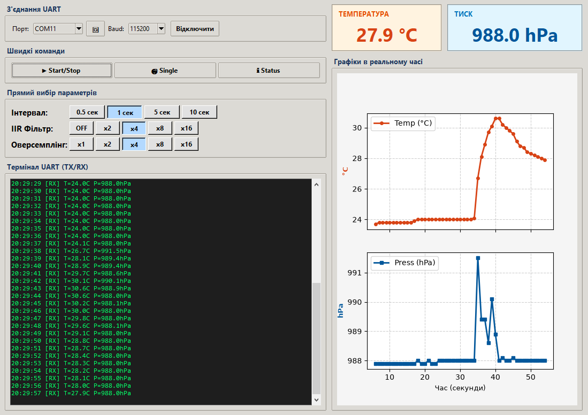

# STM32F411 + BMP280 Modular Control & Telemetry System

-blue.svg)
-yellow.svg)


Асинхронна модульна система збору, обробки та візуалізації метеоданих із датчика **BMP280** на базі мікроконтролера **STM32F411CEU6**. Взаємодія з ПК реалізована через **UART** за допомогою власного двобайтового протоколу та десктопного інтерфейсу на **Python**.



---


### Axetemp (STM32 / C)
* **Переносний драйвер (`BMP280.c` / `BMP280.h`):** Написаний з нуля без сторонніх бібліотек. Використовує вказівники на функції (`BMP280_ReadFn`, `BMP280_WriteFn`) для повної незалежності від апаратної платформи та точні цілочисельні формули компенсації з даташиту Bosch.
* **Non-blocking архітектура:** Жодних блокуючих затримок `HAL_Delay()` у робочому циклі. Опитування виконується за перериваннями апаратного таймера **TIM2**, індикація LED (`PC13`) керується асинхронно через `HAL_GetTick()`.
* **Керування енергоспоживанням:** Система стартує у режимі сну (**Sleep Mode**). Доступне перемикання в безперервний режим (**Normal Mode**) або виконання точкового вимірювання за запитом (**Forced Mode**).
* **Автомат станів (State Machine) для UART:** Прийом команд на перериваннях (`HAL_UART_RxCpltCallback`) із розбором одно- та двобайтових інструкцій без блокування шини I2C всередині ISR.
* **Відмовостійкість I2C:** Автоматичний перезапуск периферії `HAL_I2C_DeInit / Init` у разі фізичного розриву лінії зв'язку.

### Desktop GUI (Python)
* **Багатопотоковість:** Окремий фоновий потік (`threading` + `pyserial`) для безперервного читання COM-порту без зависання вікна.
* **Візуалізація в реальному часі:** Динамічні графіки температури (°C) та тиску (hPa) на базі **Matplotlib** з буферизацією останніх 60 точок та цифровими індикаторами.
* **Пряме керування регістрами:** Сегментні кнопки (`Radiobutton`) для миттєвої зміни періоду опитування, коефіцієнта IIR-фільтра та оверсемплінгу.

---

## 📡 Протокол обміну UART (115200 baud, 8N1)

| Команда | Призначення | Відповідь мікроконтролера |
| :---: | :--- | :--- |
| **`S`** | Старт / Стоп автоопитування (`Normal` $\leftrightarrow$ `Sleep`) | `[CMD] Auto-sampling STARTED / STOPPED` |
| **`R`** | Разове примусове вимірювання (`Forced Mode`) | `[CMD] Single read requested` $\rightarrow$ `T=... P=...` |
| **`H`** | Запит поточного статусу та конфігурації | `[INFO] Status: ... \| Mode: ... \| Filter: ...` |
| **`I1`..`I4`** | Інтервал таймера: `I1` (0.5с), `I2` (1с), `I3` (5с), `I4` (10с) | `[CMD] Interval set to X.X sec` |
| **`F0`..`F4`** | IIR-фільтр: `F0` (OFF), `F1` (x2), `F2` (x4), `F3` (x8), `F4` (x16) | `[CMD] IIR filter set to X` |
| **`O1`..`O5`** | Оверсемплінг: `O1` (x1), `O2` (x2), `O3` (x4), `O4` (x8), `O5` (x16) | `[CMD] Oversampling set to X` |

---

## 🔌 Підключення периферії (Pinout)

| Компонент | Вивід модуля | Пін STM32F411 | Інтерфейс |
| :--- | :---: | :---: | :--- |
| **BMP280** | `VCC` / `GND` | `3.3V` / `GND` | Живлення |
| **BMP280** | `SCL` / `SDA` | `PB6` / `PB7` | `I2C1` (100 kHz) |
| **BMP280** | `SDO` | `3.3V` *(або GND)* | I2C адреса `0x77` *(або `0x76`)* |
| **USB-UART** | `RXD` / `TXD` | `PA9` (TX) / `PA10` (RX) | `USART1` (115200 baud) |

---

## 🚀 Інструкція із запуску

1. **Прошивка STM32:**
   * Відкрийте папку `Axetemp` у **STM32CubeIDE**.
   * Зберіть проєкт (`Ctrl + B`) та зашийте у плату (`Ctrl + F11`).
2. **Запуск клієнта на ПК:**
   ```bash
   cd GUI
   pip install -r requirements.txt
   python script.py